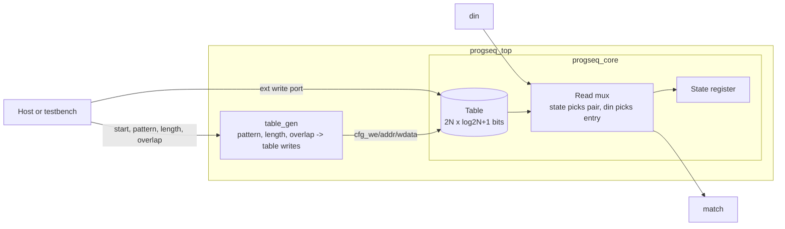

# ProgSeq

**ProgSeq (Programmable Sequence Detector)** is a reusable, synthesizable soft IP that detects a runtime-programmable bit pattern in a serial stream. It is taken from paper design through RTL, verification and a Cadence Genus/Innovus RTL-to-GDSII flow, with the architecture trade-offs measured rather than assumed.

[](https://github.com/kishlabs/progseq/actions/workflows/sim.yml)


> Current progress: [`docs/status.md`](docs/status.md).

## Why this project

SoCs need to recognise bit sequences on serial links (frame-sync words, preambles, handshake and unlock codes). Each is normally a hardcoded one-off FSM. ProgSeq replaces the one-off with a single block whose pattern is loaded at runtime, **with no re-synthesis and no RTL change**, and it contains the hardware that computes its own lookup table from the pattern.

## Key features

- Pattern length 1 to `NUM_STATES` (8 or 16), programmable at runtime
- Overlapping or non-overlapping detection, selected by table data (no extra hardware)
- Mealy output (`match`, same cycle as the last bit) plus a registered `match_q`
- On-chip **`table_gen`**: give it `pattern`, `length`, `overlap`; it builds the FSM table itself
- Direct table write port, `enable`, sticky `lock`, safe reconfiguration, rejected-start reporting (`start_err`)
- Reference designs for comparison: fixed 1011 Mealy FSM (A) and Moore FSM (A')
- Self-checking testbench with an independent reference model

## Designs in v1.0

| ID | Design | Purpose |
|---|---|---|
| **A** | Fixed 1011 Mealy FSM | Baseline and golden reference |
| **A'** | Fixed 1011 Moore FSM | Mealy vs Moore comparison |
| **C** | Programmable FSM + `table_gen` | **The IP** |

## Architecture at a glance



Details: [`docs/architecture.md`](docs/architecture.md).

## Quick start

Requirements: [Icarus Verilog](https://steveicarus.github.io/iverilog/) 12 or later and `make`.

```bash
make sim            # NUM_STATES=8
make sim N=16       # NUM_STATES=16
make regress        # N = 4, 8, 16, 32
make lint           # syntax check of the RTL
```

A passing run ends with `PASS`.

## Using the IP

```text
1. Reset.
2. Hold enable=0. Set pattern, length, overlap. Pulse start for one clock.
3. Wait for done (busy drops).
4. Set enable=1 and stream din. match is high in the cycle the last pattern bit arrives.
5. To change the pattern: enable=0, repeat from step 2.
```

Convention: `pattern[k]` is the k-th bit **received**, so detecting `1011` uses `pattern[3:0] = 4'b1101`. See [`docs/integration_guide.md`](docs/integration_guide.md).

## Repository layout

```text
progseq/
├── docs/       specification, architecture, roadmap, status, plans, ADRs, results
├── paper/      hand design (scanned): state diagrams, K-maps, circuits
├── rtl/        synthesizable Verilog
├── tb/         testbenches
├── scripts/    helper scripts (reference model, table generator)
├── formal/     equivalence/property checks (planned)
├── synth/      Genus scripts and constraints
├── pd/         Innovus scripts and constraints
└── sim/        simulation helpers
```

## Documentation

| Document | Content |
|---|---|
| [`docs/status.md`](docs/status.md) | Where the project stands today |
| [`docs/roadmap.md`](docs/roadmap.md) | Milestones and the task list |
| [`docs/specification.md`](docs/specification.md) | Requirements, interface, behaviour |
| [`docs/architecture.md`](docs/architecture.md) | Microarchitecture of every design |
| [`docs/verification_plan.md`](docs/verification_plan.md) | How correctness is shown |
| [`docs/pd_plan.md`](docs/pd_plan.md) | Synthesis, P&R, signoff, experiments |
| [`docs/results.md`](docs/results.md) | Measured numbers (filled in as runs complete) |
| [`docs/adr/`](docs/adr/) | Design decision records |
| [`docs/glossary.md`](docs/glossary.md) | Terms and conventions |
| [`docs/log.md`](docs/log.md) | Work log |

## Technology and confidentiality

The physical flow uses Cadence Genus, Innovus, Tempus, Voltus and Pegasus with a foundry-provided PDK obtained through the institution. **No PDK or library files are included in this repository**, and reports, netlists and layouts are published only where permitted. See [`docs/pd_plan.md`](docs/pd_plan.md#8-publication-policy).

## License

Apache-2.0. Add the standard `LICENSE` file when you create the repository (GitHub offers it in the "Add a license" step).
