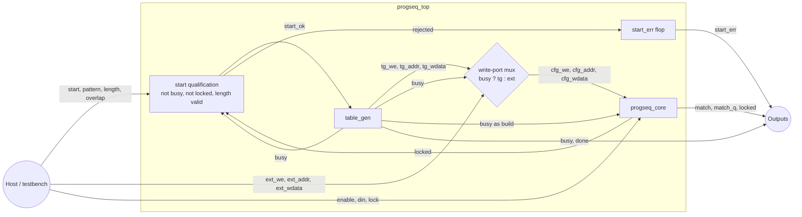
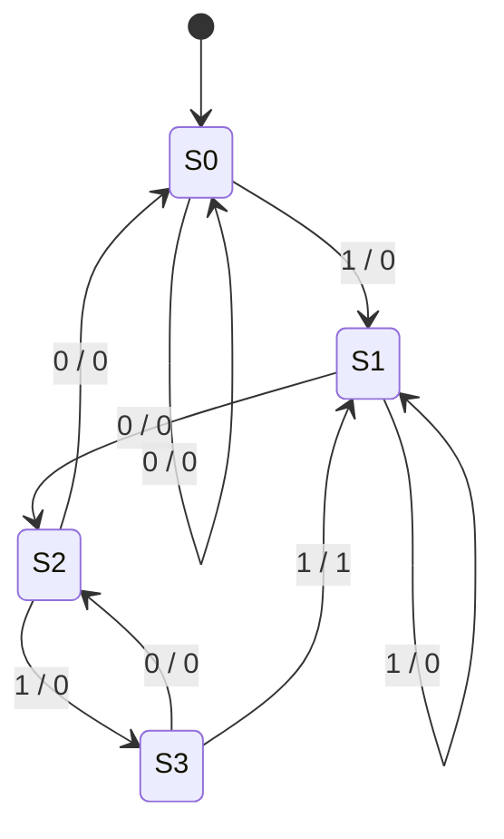
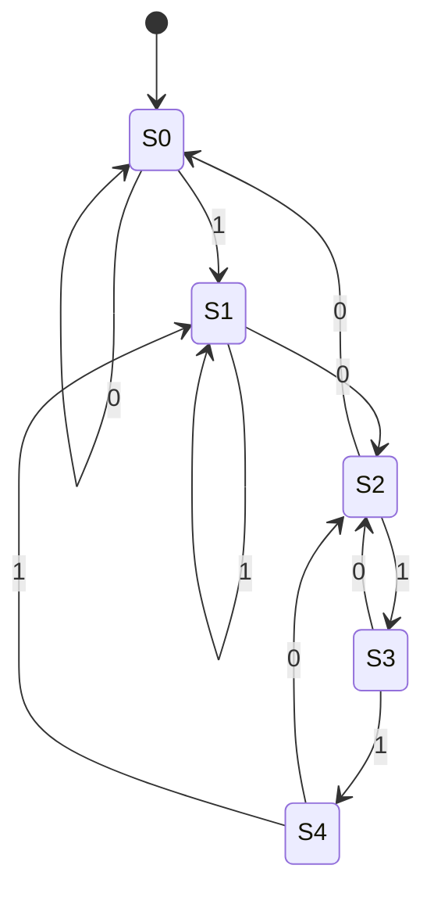
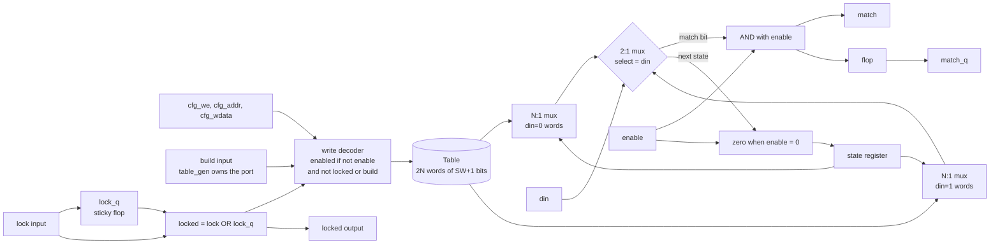
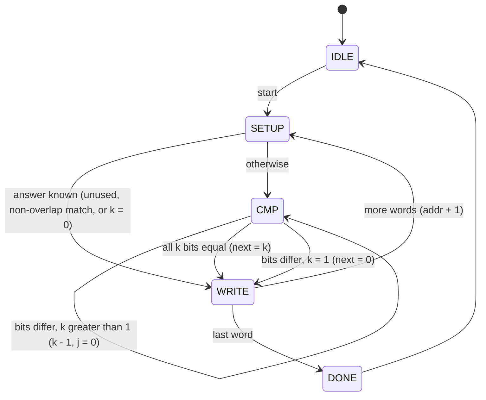
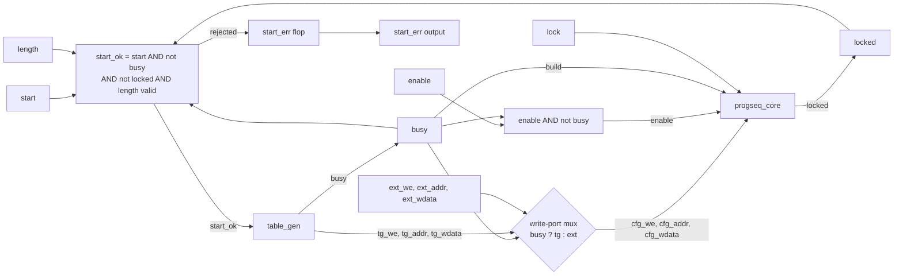

# ProgSeq Architecture

| | |
|---|---|
| Document | Architecture (microarchitecture and design rationale) |
| Version | 0.4, draft for v1.0 |
| Scope | Designs **A** (fixed Mealy), **A'** (fixed Moore), **C** (programmable FSM with `table_gen`) |
| Companion documents | [Specification](specification.md) defines *what* the IP does. This document explains *how* it is built and *why*. |

---

## 1. Purpose and design goals

ProgSeq detects a bit pattern in a serial stream. The pattern is **not fixed at design time**: it is data that can be loaded after reset, with no re-synthesis and no RTL change.

**Goals**

| # | Goal | Consequence for the design |
|---|---|---|
| G1 | Runtime-programmable pattern, length 1 to `N` | Behaviour stored as data (a table), not as gates |
| G2 | Zero-latency detection | Mealy output: `match` rises in the cycle the last bit is on `din` |
| G3 | Self-contained | An on-chip block (`table_gen`) turns a raw pattern into the table |
| G4 | Technology independent | Plain synthesizable RTL; no cell instantiation |
| G5 | Measurable trade-offs | Fixed designs (A, A') exist as baselines for the same flow |
| G6 | Small and verifiable | Few blocks, simple controller, flop-based storage |

**Non-goals for v1.0:** wildcards, simultaneous multi-pattern, event counting, alternative state encodings, clock gating, clock-domain crossing. See [section 13](#13-planned-extensions-v11).

---

## 2. Theory behind the design

### 2.1 Sequence detection is a state machine

To detect a pattern `P = P0 P1 ... P(L-1)` the machine must remember **how much of the pattern is currently matched**. Define

> state `i` = the length of the longest suffix of the bits received so far that equals a prefix of `P` (with `i < L`).

State 0 means no useful progress. State `i` means the last `i` received bits are exactly `P0 ... P(i-1)`.

### 2.2 The suffix rule (next-state function)

When bit `b` arrives in state `i`, the string that matters is `P0 ... P(i-1) b` (the last `i` received bits followed by the new bit). The next state is

> the largest `k <= min(i+1, L-1)` such that the **last `k` bits of that string equal `P0 ... P(k-1)`**, or 0 if no such `k` exists.

This is the classical automaton used by the Knuth-Morris-Pratt algorithm. The bound `L-1` is explained next.

### 2.3 Why a Mealy detector needs exactly `L` states

A full match is *not* a state. In a Mealy machine the match is an **output on the transition** taken from state `L-1` when `b = P(L-1)`. After that transition the machine continues from the longest proper suffix of the pattern that is also a prefix (the pattern's "border"), which is why `k` is limited to `L-1`: the string `P0 ... P(L-1)` itself must not be reported as progress. A Moore machine must instead have a state *for* the completed match, so it needs `L+1` states.

| Detector | States for `L = 4` | Output depends on | Output appears |
|---|---|---|---|
| Mealy | 4 | state and `din` | in the cycle of the last bit |
| Moore | 5 | state only | one cycle later |

### 2.4 Overlapping and non-overlapping

- **Overlapping:** after a match, continue from the border (the rule above). For `1011`, the border is `1`, so the machine goes to state 1.
- **Non-overlapping:** after a match, restart from state 0.

The two modes differ **only in the next-state value of the single transition that produces `match`**. This is why overlap mode costs no hardware in a table-driven design: it is one different table entry.

### 2.5 Time convention

Cycle `n` has input `din_n` and present state `s_n`. The state register updates at the rising edge that ends cycle `n`, so `s_(n+1) = next(s_n, din_n)`. Mealy: `match_n = f(s_n, din_n)`. Moore: `match_n = g(s_n)`.

---

## 3. System overview

### 3.1 Module hierarchy



**Write-port naming** (used consistently in this document and in the RTL):

| Prefix | Where | Meaning |
|---|---|---|
| `tg_*` | outputs of `table_gen` | The generator's write requests |
| `ext_*` | inputs of `progseq_top` | The host's write port |
| `cfg_*` | inputs of `progseq_core` | The core's single write port, after the write-port mux |

| Block | Role | Analogy used in the project |
|---|---|---|
| `progseq_core` | Holds the table, executes one lookup per clock | The chef reading a recipe card |
| `table_gen` | Derives the table from a pattern | The card writer |
| `progseq_top` | Arbitrates the write port, gates `enable` while building | The kitchen manager |
| Designs A, A' | Fixed 1011 detectors | Baselines for comparison |

### 3.2 Two ways to program the core

| Method | Who computes the table | When to use |
|---|---|---|
| By pattern | `table_gen` (on-chip) | Normal use: give `pattern`, `length`, `overlap` |
| By table | An external host writes every entry through the `ext_*` port | Custom behaviour, or when `table_gen` is not wanted |

Both end the same way: entries arrive on the core's single write port.

---

## 4. Design A: fixed Mealy detector (reference)

The hand-derived design, used as the golden reference for the programmable core.

### 4.1 State diagram (pattern 1011, overlapping)



Labels are `din / match`. The transition S3 to S1 with `1 / 1` is the overlap: after `1011` the final `1` already starts the next match.

Reading the table with the suffix rule:

| State (bits matched) | `din=0`: string, next | `din=1`: string, next |
|---|---|---|
| S0 (none) | `0`, no suffix is a prefix, S0 | `1`, `1` is a prefix, S1 |
| S1 (`1`) | `10`, `10` is a prefix, S2 | `11`, only `1` is a prefix, S1 |
| S2 (`10`) | `100`, none, S0 | `101`, S3 |
| S3 (`101`) | `1010`, `10` is a prefix, S2 | `1011` full match, border `1`, S1, match = 1 |

### 4.2 Minimality

No two states are equivalent, so 4 states is minimal and 2 flip-flops suffice.

- **S3** is the only state whose output can be 1 (on `din=1`), so it differs from all others.
- **S2** differs from S0 and S1: on `din=1` it moves to S3, while S0 and S1 move to S1, and S3 is already distinguishable.
- **S0** differs from **S1**: on `din=0` they move to S0 and S2 respectively, and S2 and S0 were just shown to be distinguishable.

### 4.3 Reference implementation (binary assignment S0=00, S1=01, S2=10, S3=11)

With state `Q1 Q0` and input `x = din`:

| Next-state bit | Equation | Derivation |
|---|---|---|
| `D0` | `x` | Every state has next-state bit 0 equal to `din` |
| `D1` | `Q0·x' + Q1·Q0'·x` | Next-state bit 1 is 1 for (S1,0), (S2,1), (S3,0); (S1,0) and (S3,0) merge into `Q0·x'` |
| `match` | `Q1·Q0·x` | Only (S3, `din=1`) |

Hardware: 2 state flip-flops, one 3-input AND for `match`, about three gates for `D1`, no logic for `D0`. The output path `din` to `match` is a single AND gate. (The hand-derived design is archived in [`paper/`](../paper/README.md). If it uses a different state assignment, only these equations change.)

---

## 5. Design A': fixed Moore detector

### 5.1 State diagram



Output is 1 only in S4 (`1011` just completed). S4's outgoing transitions equal S1's: after a full match the useful tail is `1`, exactly what S1 represents. S4 and S1 are still distinct states because their outputs differ.

### 5.2 Mealy vs Moore, same input `1 0 1 1 0`

```text
cycle         1    2    3    4    5    6
din           1    0    1    1    0    -
Mealy state   S0   S1   S2   S3   S1   S2
Mealy match   0    0    0    1    0    0      <- same cycle as the 4th bit
Moore state   S0   S1   S2   S3   S4   S2
Moore match   0    0    0    0    1    0      <- one cycle later
```

| | A (Mealy) | A' (Moore) |
|---|---|---|
| States | 4 | 5 |
| State flip-flops (binary) | 2 | 3 |
| Output logic | AND of state and `din` | Decode of state only |
| Latency | 0 cycles | 1 cycle |
| `din` to output path | combinational | none |
| Output glitch exposure | `din` glitches reach the output | no `din` path, but the state decode can glitch when several state bits change at once (for example S3 = 011 to S4 = 100 in binary) |

A Moore output is glitch-free only when it comes straight from a flip-flop (a registered output, or one bit of a one-hot state register). A decoded output needs the same registering as the Mealy `match` (see section 6.7).

This pair isolates the Mealy/Moore trade-off in the later physical-design comparison.

---

## 6. Design C: the programmable FSM core

### 6.1 The key idea

Design A takes its state table through K-maps and turns it into gates, so the pattern is frozen into the wiring. Design C **keeps the table as data** in flip-flops. The surrounding circuit is generic and never mentions a particular pattern.

```text
Design A :  table --(K-maps)--> gates                  pattern = wiring
Design C :  table ------------> stored in flip-flops   pattern = contents
```

One clock of design C is always the same four steps: form the address `{state, din}`, read that word, output its `match` bit, and store its `next` field in the state register.

### 6.2 Table format

| Item | Definition |
|---|---|
| Address | `{state[SW-1:0], din}` (`SW = log2 N`) |
| Word | `{match, next_state[SW-1:0]}` (`SW + 1` bits) |
| Depth | `2N` words |

Example: `1011`, overlapping, `N = 8`.

| Address | State, `din` | Word |
|---|---|---|
| 0000 | S0, 0 | 0_000 |
| 0001 | S0, 1 | 0_001 |
| 0010 | S1, 0 | 0_010 |
| 0011 | S1, 1 | 0_001 |
| 0100 | S2, 0 | 0_000 |
| 0101 | S2, 1 | 0_011 |
| 0110 | S3, 0 | 0_010 |
| 0111 | S3, 1 | 1_001 |
| 1000 to 1111 | S4 to S7 | 0_000 (unused, recovers to S0) |

Non-overlapping differs only at address 0111, which holds `1_000`.

A shorter pattern in a larger table simply leaves the high states unused. Unused words hold zero, so any stray entry into them returns to S0.

### 6.3 Block diagram



### 6.4 Structure of each part

**Table storage.** `2N x (SW+1)` flip-flops with an enable (write) and an asynchronous reset to zero. A word is written only when the write decoder selects it.

**Write decoder.** Decodes the `SW+1`-bit `cfg_addr` into `2N` word-enable lines, each ANDed with `cfg_we`, `NOT enable` and `(NOT locked OR build)`. Only one word changes per write. `build` is the `busy` signal of `table_gen`, supplied by `progseq_top`: while a build is in progress its writes are exempt from the lock, so that a `lock` raised in the middle of a build cannot leave the table half-written.

**Lock register.** One flip-flop `lock_q` is set whenever the `lock` input is seen high and is cleared **only by reset**. `locked = lock OR lock_q` blocks host writes immediately (a write in the same cycle as the first `lock` is already blocked), and releasing the `lock` input does **not** unlock the table. `locked` is also an output so the host can read the state. The `lock` input is therefore a request, and the stickiness lives inside the IP.

**Lock during a build.** The request is accepted at once (`lock_q` sets and `locked` reads 1), but the build in progress completes normally because `build` overrides the lock for `table_gen` writes. The table is therefore frozen **complete**, from `done` onward. A locked table can never start a new build (section 8), so this override cannot be used to modify a locked table.

**Lock and reset.** Reset clears `lock_q` **and the entire table**, so a locked table can be unlocked only by erasing it. Lock followed by reset does not preserve the pattern; it must be loaded again after reset.

**Read path.** The state register selects a *pair* of words (the `din=0` word and the `din=1` word). This is two `N:1` multiplexers, one over the even-addressed words and one over the odd-addressed words. A final 2:1 multiplexer controlled by `din` picks one of the two.

**State register.** `SW` flip-flops, asynchronous reset to 0. It loads the `next` field each clock when `enable = 1` and is forced to 0 when `enable = 0`.

**Outputs.** `match = enable AND (match bit of the selected word)`. `match_q` is that value registered once.

### 6.5 Why `din` is the last mux stage

`din` is an input that can change late in the cycle, and `match` depends on it combinationally, so the `din` to `match` path is the critical input-to-output path of any Mealy design. If `din` were the first select, it would travel through the whole read tree (`log2 N` levels plus one). With `din` as the final select, it crosses **one 2:1 mux and one AND gate**, independent of `N`. The state-dependent part of the tree is driven by flip-flop outputs, which are available at the start of the cycle and can settle in parallel with the arrival of `din`.

| Select order | Levels from `din` to `match` | Levels from `state` to `match` |
|---|---|---|
| `din` first | `log2 N + 1` (plus AND) | `log2 N + 1` (plus AND) |
| `din` last (chosen) | 1 (plus AND) | `log2 N + 1` (plus AND) |

### 6.6 Behaviour rules built into the structure

| Rule | How the structure enforces it |
|---|---|
| Writes only while idle | Write decoder gated by `NOT enable` |
| Frozen configuration | Write decoder gated by `(NOT locked OR build)`; `lock_q` is sticky and cleared only by reset (which also clears the table) |
| Complete table at lock | A build in progress is exempt from the lock, so locking never leaves a half-written table |
| Clean start | `enable = 0` forces the state to 0, so detection always begins at S0 |
| Safe default | Reset clears every word to zero ("next S0, no match") |
| Illegal state recovery | Unused words are zero, and `N` is a power of two so every state value is valid |
| Glitch-safe external output | `match_q` is registered |

### 6.7 Why `match_q` exists

`match` is combinational from `din` and from a mux tree. A multiplexer whose select line changes between two inputs that both hold the same value can still produce a brief glitch (a static hazard). The state register only samples at clock edges, so internal glitches are harmless, but a downstream block that treats `match` as an asynchronous event or clock could misfire. `match_q` is the same information, registered, so it changes only at a clock edge. The same reasoning applies to a decoded Moore output (section 5.2): only a flip-flop output is glitch-free.

### 6.8 Timing paths (logic-level analysis)

| ID | Path | Logic between | Class |
|---|---|---|---|
| P1 | `din` to `match` | final 2:1 mux, AND(`enable`) | input to output, combinational |
| P2 | state flops to `match` | `log2 N` mux levels, final mux, AND | clock to output |
| P3 | `din` to state flops | final mux, enable gating | input to register |
| P4 | state flops to state flops | `log2 N` mux levels, final mux, enable gating | register to register |
| P5 | `cfg_*`, `build`, `lock_q`, `lock`, `enable` to table flops | address decode, AND, flop enable | input to register |

Expected limits: **P1** is constrained by the input and output delays (the logic must fit in the part of the period left after both), and **P4** is the longest internal path and sets the maximum clock frequency. Both are measured later in the implementation phase.

### 6.9 Cost model (hand estimate)

Let `N` be `NUM_STATES`, `SW = log2 N`.

| Item | Formula | N = 8 | N = 16 |
|---|---|---|---|
| Table flops | `2N (SW+1)` | 64 | 160 |
| State flops | `SW` | 3 | 4 |
| `match_q` flop | 1 | 1 | 1 |
| `lock_q` flop | 1 | 1 | 1 |
| **Core flops** | sum | **69** | **166** |
| Read mux (2:1 equivalents) | `(2N-1)(SW+1)` | 60 | 155 |
| Write decoder word enables | `2N` | 16 | 32 |
| Per-bit write enable (mux or enable flop) | `2N (SW+1)` | 64 | 160 |

`progseq_top` adds one flop (`start_err`) and a few gates for start qualification (section 8). Design A needs 2 state flops (3 with `match_q`) and about five gates. The ratio between A and C at the same pattern is the **price of programmability**, to be compared with the synthesis results.

### 6.10 Storage alternatives considered

| Option | Verdict |
|---|---|
| Flip-flop array (chosen) | Uses only standard cells; simplest flow; largest per bit |
| Latch array | Smaller per bit, but needs careful timing and verification; possible v1.1 study |
| SRAM / register-file macro | Needs a macro and different flow; far too large for 64 to 160 bits |
| Hard-wired ROM per pattern | That is design A again |

---

## 7. table_gen: the on-chip table generator

### 7.1 Purpose

The core can execute any table but cannot compute one. `table_gen` computes the table from a pattern, so the IP accepts a raw pattern. It performs the suffix rule of [section 2.2](#22-the-suffix-rule-next-state-function) in hardware, one bit comparison per clock, and delivers the result as writes to the core.

### 7.2 Interface

| Direction | Signals | Meaning |
|---|---|---|
| Input | `start` | One-clock pulse; begin building. Driven by `start_ok` from `progseq_top` (section 8), not directly by the host |
| Input | `pattern[N-1:0]`, `length`, `overlap` | What to build; `pattern[k]` is the k-th bit received |
| Output | `tg_we`, `tg_addr`, `tg_wdata` | One write per table word |
| Output | `busy`, `done` | Building / finished (one-clock pulse) |

`table_gen` produces no detection output; its only product is the table.

**Bit-order convention.** `pattern[k]` is the *k-th bit received*, so the first bit to arrive sits at index 0. This is the reverse of how a sequence is usually written. To detect the sequence `1, 0, 1, 1` (received in that order) set `pattern[3:0] = 4'b1101` and `length = 4`. A palindrome such as `01110` looks the same either way, so do not rely on it when checking.

**Precondition.** `1 <= length <= NUM_STATES`. `progseq_top` enforces this (section 8). With an invalid length `table_gen` itself is undefined: for `length = 0`, `L-1` wraps to all ones in `SW+1` bits, so no state is ever "last" and every state counts as unused; for `length > NUM_STATES` no state is ever "last" either.

### 7.3 Algorithm

```text
latch P, L, overlap
for each word address {i, b}  (i = state, b = din), in increasing order:
    last   = (i == L-1)
    unused = (i >= L)
    match  = last AND (b == P[L-1])
    if unused:                 next = 0
    else if match AND not overlap: next = 0
    else:
        k = last ? i : i + 1            # largest allowed guess
        while k > 0:
            compare, for j = 0 .. k-1:
                received bit at position (i+1-k+j)   vs   P[j]
            if all k bits equal:  next = k; stop
            else:                 k = k - 1
        if no k succeeded: next = 0
    write {match, next} to address {i, b}
```

### 7.4 Why this is correct

1. **State meaning gives the received bits for free.** Being in state `i` means the last `i` received bits are `P0 ... P(i-1)`. So the received string for box `(i, b)` is `P0 ... P(i-1) b`, and no history needs to be stored.
2. **Rebuilding a received bit.** For a position `p` in that string: if `p = i` it is `b`, otherwise it is `P[p]`.
3. **Which positions are compared.** For a guess `k`, the last `k` received bits start at position `(i+1) - k`. Column `j` of the comparison pairs received position `(i+1) - k + j` with `P[j]`. The newest bit `b` is reached exactly in the last column (`j = k-1`).
4. **Largest guess first.** The rule asks for the *longest* suffix that is a prefix, so guesses descend from the maximum and the first success is the answer.
5. **Bound on `k`.** For `i < L-1`, `k <= i+1 <= L-1` automatically. For `i = L-1` the bound `L-1` excludes the full string. If `b = P(L-1)` that string equals the pattern (a match, not progress); if `b` differs it cannot equal the pattern anyway.
6. **`match`.** The pattern completes exactly when the machine is in the last state and `b` equals the last pattern bit.
7. **Unused words.** States at or above `L` can never be reached with the programmed pattern, so writing zeros there both is safe and erases the previous pattern completely.

### 7.5 Datapath

| Element | Width | Meaning |
|---|---|---|
| `P` | `N` | Latched pattern |
| `L` | `SW+1` | Latched length |
| `ovl` | 1 | Latched overlap mode |
| `addr = {i, b}` | `SW+1` | Word being built; also drives `tg_addr` |
| `k` ("Trying") | `SW` | Current guess; counts down. At most `N-1` |
| `j` ("which bit") | `SW` | Current comparison column; counts up. At most `N-2` |
| `nxt` | `SW` | Result for the current word |
| `mreg` | 1 | `match` of the current word |

Combinational arithmetic, all evaluated within one clock (not time-shared in v1.0):

| Unit | Operation | Notes |
|---|---|---|
| Decrementer | `L - 1` | Last-state index |
| Incrementer | `i + 1` | Shared by `kstart` and `pos` |
| Adder/subtractor | `pos = (i+1) - k + j` | Two operations, `SW+1` bits |
| Incrementer | `j + 1` | Shared with the `last_col` comparison |
| Decrementer | `k - 1` | Guess countdown |
| Incrementer | `addr + 1` | Next word |
| Comparators | `i == L-1`, `i >= L`, `(j+1) == k`, `k == 1`, `addr == all ones` | Small |
| Bit selectors | `P[L-1]`, `P[pos]`, `P[j]` | Three `N:1` multiplexers |
| XNOR | `recv == pat` | The one-bit comparison |

The width `SW` of `k` and `j` is enough because `k <= N-1` and `j < k`; only the position arithmetic needs `SW+1` bits (`i + 1` can equal `N`).

### 7.6 Controller



| State | Job | Outputs |
|---|---|---|
| IDLE | Wait for `start`; on start latch `P`, `L`, `ovl`, clear `addr` | none |
| SETUP | Compute `match`; decide whether the answer is immediate or a comparison is needed; load `k`, clear `j` | none |
| CMP | Compare one bit pair; change `k`, `j` or finish | none |
| WRITE | Present the word to the core; advance `addr` | `tg_we = 1` |
| DONE | Signal completion | `done = 1` |

`busy` is high in every state except IDLE.

### 7.7 Worked example: pattern 1011, word (S3, din = 0)

Received string `1 0 1 0`, start guess `k = 3`.

| Clock | `k` | `j` | Received bit | Pattern bit | Equal | Action |
|---|---|---|---|---|---|---|
| 1 | 3 | 0 | `P1` = 0 | `P0` = 1 | no | `k = 2`, `j = 0` |
| 2 | 2 | 0 | `P2` = 1 | `P0` = 1 | yes | `j = 1` |
| 3 | 2 | 1 | `b` = 0 | `P1` = 0 | yes, last column | next = 2 |

The word `0_010` is written at address 0110, matching the hand-derived table.

### 7.8 Timing of a build

Counting clocks from the edge that samples `start` until `done` is high:

`clocks = 1 + 2 x (number of words) + (comparison clocks over all words)`.

Each word costs one SETUP and one WRITE clock plus one clock per bit comparison. A guess `k` costs at most `k` comparisons, which gives only a loose bound (`k0 (k0+1) / 2` per word).

The true worst case is a pattern whose **first `N-1` bits are all equal** (all zeros or all ones), at full length (`length = N`) and in overlap mode. Every wrong-bit word then fails each guess at its last column. The last pattern bit may have either value: `P[L-1]` is never compared with a received bit (comparisons use `P[0..L-2]` only); it only decides which of the two last-state words carries `match`, and in overlap mode the comparison count of those words does not depend on it. So **four patterns tie** (two values for the repeated bit times two for the last bit), as the exhaustive N = 4 and N = 8 runs show. In non-overlap mode the match word skips its comparison and the build is shorter. Summing over all words gives a closed form:

`worst-case clocks = 1 + 4N + (N^2 - 1)(N + 6) / 6`

| N | Closed form | Exhaustive RTL simulation |
|---|---|---|
| 4 | 42 | 42 (all patterns, all lengths, both modes; four patterns tie) |
| 8 | 180 | 180 (all patterns, all lengths, both modes) |
| 16 | 1000 | 1000 (all patterns at lengths 15 and 16, overlapping) |
| 32 | 6608 | not simulated |

Typical builds are much shorter, since most words fail on the first comparison, and shorter lengths skip the unused words. Build time is not performance critical: it occurs once per pattern change.

### 7.9 Alternatives considered

| Alternative | Verdict |
|---|---|
| Compute tables in software on a host | Valid and supported through `ext_*`, but then the IP cannot take a raw pattern |
| Compare all columns in parallel | About `N` times fewer clocks, but a wide comparator; area not justified for a rare operation. Candidate experiment for v1.1 |
| Store the received string in a register | Unnecessary; the string is a function of `P`, `i` and `b` |
| Closed-form border computation (failure function) | Needs an array of failure values and a second pass; more storage than the direct method |

### 7.10 Cost model (hand estimate)

| Item | Formula | N = 8 | N = 16 |
|---|---|---|---|
| `P` | `N` | 8 | 16 |
| `L` | `SW+1` | 4 | 5 |
| `ovl`, `mreg` | 2 | 2 | 2 |
| `addr`, `k`, `j` | `(SW+1) + 2 SW` | 10 | 13 |
| `nxt` | `SW` | 3 | 4 |
| Controller state | 3 | 3 | 3 |
| **`table_gen` flops** | sum | **30** | **43** |

Logic: the arithmetic units of section 7.5, which amount to about five incrementer/decrementer units, one two-operation adder/subtractor, five small comparators, three `N:1` bit selectors and one XNOR. This is the area price of the IP being self-contained, to be reported separately in the results. Time-sharing the arithmetic across clocks would reduce area at the cost of a larger controller; synthesis may also merge some units.

---

## 8. progseq_top: integration logic



| Function | Mechanism |
|---|---|
| Write-port ownership | While `busy`, `table_gen` drives the core's write port; otherwise the external port does |
| Detector held idle during a build | Core `enable = enable AND NOT busy`, which also keeps its write decoder open |
| No restart during a build | `start` is ignored while `busy` |
| **Start qualification** | `start_ok = start AND NOT busy AND NOT locked AND (1 <= length <= NUM_STATES)`. Only `start_ok` reaches `table_gen` |
| **Rejection is visible** | If `start` arrives while not busy but is not `start_ok` (locked table or invalid length), nothing else happens (detection is not interrupted, no write, no `done`). `start_err` is a flop, so it pulses for one clock in the cycle **after** the rejected `start` |
| Locked configuration | `locked` comes from the core; a locked table can neither be written by the host nor rebuilt until reset |
| **Lock during a build** | The build completes (`build = busy` exempts `table_gen` writes from the lock); the table is frozen complete at `done` (section 6.4) |

Behavioural consequence: pulsing a *valid* `start` while `enable = 1` **interrupts detection** (the core is idle during the build and begins again from S0 afterwards). This is intended: the table must never change under a running detector.

### 8.1 Write-port protocol (table_gen to core)

During WRITE, `tg_we` is high for exactly one clock with `tg_addr` and `tg_wdata` stable. While `busy`, the write-port mux passes them to the core as `cfg_we`, `cfg_addr`, `cfg_wdata`. The core captures the word at the clock edge that ends that cycle, and `table_gen` advances `addr` at the same edge. Every word is written once, in address order.

### 8.2 Programming sequence

```text
clk      _/‾\_/‾\_/‾\_/‾\_/‾\_ ... _/‾\_/‾\_/‾\_
enable   ____________________ ... ______________/‾‾‾‾‾‾
start    ___/‾‾‾\___________ ...
busy     _______/‾‾‾‾‾‾‾‾‾‾‾‾ ... ‾‾‾‾‾‾\_________
tg_we    ___________/‾\__/‾\_ ... (one pulse per word)
done     ...                 ... ____/‾\_________
                                      ^ table complete; enable may rise
```

---

## 9. Clocking and reset architecture

| Aspect | Decision |
|---|---|
| Clock domains | One clock, rising edge; no clock-domain crossing inside the IP |
| Asynchronous inputs | `din` and all controls must already be synchronous to `clk` (an on-chip synchronizer is planned for v1.1) |
| Reset | Asynchronous assert, active low. It clears the core state, the entire table, `match_q`, `lock_q` and `start_err`, and returns `table_gen` to IDLE |
| Reset release | Should be synchronous to `clk` (external reset synchronizer; internal one is planned for v1.1) |
| Clock gating | None in v1.0 |

---

## 10. Requirements traceability

| Requirement (see specification) | Realised by |
|---|---|
| FR-1, FR-4 (sampling, zero-latency match) | Section 6.5: Mealy read with `din` as last select |
| FR-2 (length 1..N) | Sections 7.3, 7.4: `L`, `last`, `unused` |
| FR-3 (overlap modes) | Section 2.4: one table entry; handled in `table_gen` SETUP |
| FR-5 (registered match) | Section 6.7 |
| FR-6, FR-7 (enable, reset) | Sections 6.4, 6.6, 9 |
| FR-8, FR-9 (lock, safe reconfiguration) | Section 6.4 (sticky lock, write decoder); section 8 (start qualification, `busy` gating) |
| FR-10 (table generation) | Section 7 |
| FR-11 (direct write port) | Sections 3.2, 8 |
| FR-12 (parameter `NUM_STATES`) | Section 6.2, 6.9 |
| FR-13, FR-14 (Moore, reference A) | Sections 4, 5 |
| FR-15 (rejected `start`, `start_err`) | Section 8 start qualification |
| Sticky `lock` and `locked` output | Section 6.4 (lock register, lock during a build, lock and reset) |
| Complete table when locked | Section 6.4 `build` override; section 8 |

---

## 11. Design alternatives (summary)

| Question | Chosen | Rejected | Reason |
|---|---|---|---|
| Where does behaviour live | Table in flip-flops | Gates per pattern | Needs runtime programmability |
| Read-mux order | `din` last | `din` first, flat `2N:1` | Shortest critical I/O path |
| Table computation | On-chip `table_gen` | External software only | Self-contained IP |
| `table_gen` comparison | Serial, one bit per clock | Parallel columns | Area over build time |
| Table storage | Flip-flops | Latches, SRAM | Simplicity, standard cells only |
| Match output | Mealy `match` plus registered `match_q` | Moore only | Zero latency available; glitch-safe option provided |

Decisions are recorded in [`adr/`](adr/README.md).

---

## 12. Limitations (v1.0)

- One pattern at a time; no wildcard bits.
- `NUM_STATES` must be a power of two, because the `SW`-bit state register must have exactly `N` valid values (so every state value is a legal state). The RTL has been simulated for 4, 8, 16 and 32; v1.0 implementation targets 8 and 16 (a scope choice, not a structural limit).
- Detection stops while a table is being built.
- No readback of the table.
- `length` must satisfy `1 <= length <= NUM_STATES`. `progseq_top` rejects any other value with `start_err` (section 8). Driving `table_gen` directly with an invalid length is undefined (section 7.2).
- A locked table cannot be changed or rebuilt until reset, and that reset erases it (section 6.4).

---

## 13. Planned extensions (v1.1)

| Extension | Architectural sketch |
|---|---|
| **Design B: shift-register matcher** | A window of the last `N` received bits compared with a pattern register each clock. `match = AND over bits of (NOT mask OR (window XNOR pattern))`. Needs no table and no generator. Wildcards cost one mask bit per pattern bit. A validity counter suppresses matches before `L` bits have arrived. Non-overlap mode needs a small skip counter. |
| Multi-pattern | One comparator per pattern sharing the window (design B), or a shared automaton with a multi-bit match field (design C) |
| Event counter | Counter on `match` with configurable width, saturate or wrap, overflow flag |
| State encodings | Gray and one-hot state registers; the table keeps binary values with an encoder or decoder at the boundary |
| Synchronizers, clock gating | Input and reset synchronizers; ICG wrapper around the core |

---

## 14. Pending RTL alignment

This document is the design intent. The RTL has not been changed for version 0.4, and differs in one place:

| Item | Architecture 0.4 requires | RTL today | Change needed later |
|---|---|---|---|
| Lock during a build | Write enable = `cfg_we AND NOT enable AND (NOT locked OR build)`, with `build = busy` from the top | The core gates writes with `NOT locked` only, so a `lock` raised mid-build drops the remaining `tg_*` writes: the table is left half-written while `done` still pulses | Add a `build` input to `progseq_core`, connect `busy` to it in `progseq_top`, and add a testbench case that raises `lock` during a build and checks the finished table |

## 15. Revision history

| Version | Date | Change |
|---|---|---|
| 0.1 | 2026-11-22 | First outline |
| 0.2 | 2026-11-22 | Full rewrite: theory, designs A, A', C, `table_gen`, top, timing, cost model, alternatives |
| 0.3 | 2026-11-22 | Review fixes: sticky `lock` and `locked` output; start rejection and `start_err`; length validity; Moore glitch claim; arithmetic unit count; `tg_*`/`ext_*`/`cfg_*` naming; bit-order example; `k`/`j` width; exact build-time worst case |
| 0.4 | 2026-11-22 | Second review: lock raised during a build (build exempt from the lock, `build` input); `start` source clarified; worst-case build pattern tie explained; `start_err` timing; lock-and-reset behaviour; diagram corrections; pending-RTL-alignment section |
