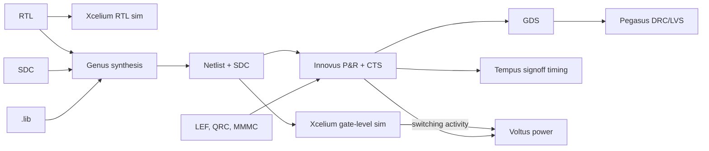

# Synthesis and Physical Design Plan

Physical design is the largest pillar (about 40% of effort). **Order of work:** Genus and Innovus to a clean GDS first; Xcelium gate-level, Tempus, Voltus and Pegasus after.

## 1. Technology (fill in when the PDK arrives)

| Item | Value |
|---|---|
| Foundry / PDK name | TBD (via ChipIN) |
| Node | TBD |
| Standard-cell library | TBD |
| Corners available | TBD (slow / typical / fast) |
| Metal layers, routing directions | TBD |
| Tool versions | Genus 25.1, Innovus 25.1; Tempus, Voltus, Pegasus, Xcelium: TBD |

## 2. Flow

## 3. Required inputs

| Stage | Files |
|---|---|
| Genus (minimum) | RTL, `.lib` (slow corner), SDC |
| Innovus | Genus netlist and SDC, `.lib`, tech LEF + cell LEF, QRC tech file (or cap table), MMMC file, cell GDS, GDS layer map |
| Gate-level sim | Cell Verilog models |
| Pegasus | DRC and LVS rule decks, cell GDS |

## 4. Scripts (templates in `synth/` and `pd/`)

The scripts are **templates written for the Common UI of Genus/Innovus 25.1 and have not yet been run**. Verify each command with `help <command>` and the lab's reference flow, then remove the TEMPLATE banner.

| File | Purpose |
|---|---|
| `synth/genus.tcl` | Read, elaborate, constrain, synthesize, report, write netlist |
| `synth/constraints_template.sdc` | Clock, input/output delays |
| `pd/mmmc_template.tcl` | Libraries, RC corner, delay corner, analysis views |
| `pd/innovus.tcl` | Import, floorplan, power, place, CTS, route, fill, verify, stream out |

Conventions: all runs are scripted; one run directory per run named `<design>_<clk_ns>_<yyyymmdd>`; checkpoints saved after place, CTS and route; every run writes its config next to its reports.

## 5. Constraints

| Item | Choice |
|---|---|
| Clock | One clock `clk`; initial period relaxed, then swept |
| Input delay | 30% of the period on all inputs except `clk` |
| Output delay | 30% of the period on all outputs |
| Critical combinational path | `din` to `match`: constrained by the input and output delays, leaving 40% of the period for the logic |
| Reset | Async `rst_n` is treated as a reset, not timed as a data path; recovery/removal checked in P&R |

## 6. Experiments (v1.0)

| Experiment | Compare | Why |
|---|---|---|
| Mealy vs Moore (A vs A') | Latency, cells, area, critical path | Classic trade-off with real numbers |
| Fixed vs programmable (A vs C) | Area, power, fmax | Price of programmability |
| With and without `table_gen` | Area share of `table_gen` | Cost of a self-contained IP |
| `NUM_STATES` 8 vs 16 | Area, fmax | How the table scales |
| Clock-period sweep | Slack, fmax, area | Timing closure behaviour |
| Constraint sweep | I/O delay percentage, effort level | Effect of constraints |
| Switching activity | Dynamic power from Xcelium activity | Power analysis |
| Hand vs tool | Estimated flops/gates vs Genus report | Validates the hand model |
| Critical-path analysis | Which path limits and why | Interview-grade explanation |

## 7. Sign-off criteria

| Check | Pass condition |
|---|---|
| Setup and hold (Innovus, then Tempus) | Slack >= 0 at all analysed corners |
| DRC (Innovus, then Pegasus) | 0 violations |
| Connectivity / LVS | 0 opens and shorts; LVS clean |
| Gate-level simulation | Equals RTL |
| Reproducibility | Every number traces to a script and run directory |

If something fails, fix in this order: connectivity, DRC, timing.

## 8. Publication policy

This repository is public. PDK and library data are covered by licences or NDAs.

| Item | Rule |
|---|---|
| PDK, `.lib`, LEF, QRC, cell GDS | **Never commit** (blocked in `.gitignore`) |
| RTL, testbenches, scripts, paper work, documentation | Publish |
| Netlists, SDF, GDS, tool reports, layout screenshots | Keep out of the repo until ChipIN / the institution confirms in writing what may be published |
| Result numbers (area, power, fmax) | Confirm that summarised values are allowed; if unsure, publish ratios and trends rather than absolute values |
| Scripts | Publish with tool paths and library paths as variables, never absolute paths into the PDK |

Record the answer you receive here: `TBD`.
