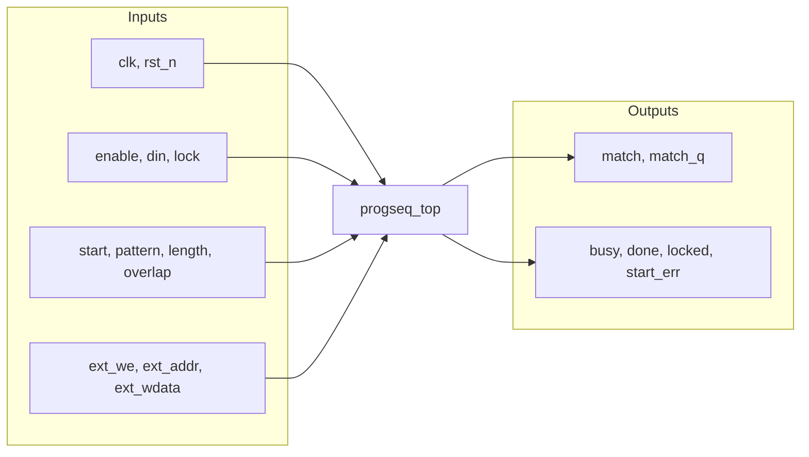

# ProgSeq Specification

| | |
|---|---|
| Document | Functional and interface specification |
| Version | 1.0-draft, scope **v1.0** |
| Status | Ready for review; frozen for v1.0 once approved. Changes after that need an [ADR](adr/README.md) |
| Companion documents | [Architecture](architecture.md) explains *how* the IP is built. This document defines *what* it does. |

The words **shall** and **shall not** mark requirements. Each requirement has an ID that the [verification plan](verification_plan.md) and the [architecture](architecture.md) refer to.

---

## 1. Overview

ProgSeq is a synthesizable soft IP that detects a bit pattern in a serial stream. The pattern is **data, not structure**: it is loaded after reset, without re-synthesis or any RTL change. The IP includes an on-chip generator (`table_gen`) so a raw pattern is all the host has to supply.

### 1.1 Deliverable designs (v1.0)

| ID | Design | Module | Purpose |
|---|---|---|---|
| **C** | Programmable FSM with `table_gen` (**the IP**) | `progseq_top` | Runtime-programmable detector |
| **A** | Fixed 1011 Mealy FSM | `fsm_1011` | Baseline and functional reference for C |
| **A'** | Fixed 1011 Moore FSM | `fsm_1011_moore` | Mealy vs Moore comparison |

Designs A and A' exist as reference points for verification and for the area, timing and power comparison. Sections 3 to 9 specify C. Section 10 specifies A and A'.

### 1.2 Feature summary

- Pattern length 1 to `NUM_STATES`, loaded at run time
- Overlapping and non-overlapping detection
- Zero-latency Mealy output plus a registered output
- On-chip table generation from a raw pattern, with a rejected-start report
- Direct table write port for host-computed tables
- Sticky configuration lock
- `enable` control and asynchronous reset

### 1.3 Out of scope for v1.0

Wildcard (don't-care) bits, simultaneous multiple patterns, event counter, alternative state encodings, clock gating, input and reset synchronizers, table readback, bus (APB/AXI) wrapper. See [section 13](#13-planned-for-v11).

---

## 2. Conventions

| Item | Convention |
|---|---|
| Pattern bit order | `pattern[k]` is the **k-th bit received**; the first bit to arrive is `pattern[0]`. To detect the sequence `1, 0, 1, 1` set `pattern[3:0] = 4'b1101`, `length = 4`. |
| Length | `L` = number of valid pattern bits |
| Clock | One clock `clk`, rising edge. Every "cycle" is one clock period |
| Cycle numbering | Cycle `n` has input `din_n`. State registers update at the edge that ends the cycle |
| "Sampled" | A signal is *sampled* at the rising edge that ends the cycle in which it is stable |
| Active-low | Signals ending in `_n` |
| `N` | `NUM_STATES`. `SW = log2(N)` |
| Write-port names | `ext_*` host write port; `tg_*` and `cfg_*` are internal ([architecture 3.1](architecture.md#31-module-hierarchy)) |

---

## 3. Interface of progseq_top



### 3.1 Parameters

| Parameter | Values | Meaning |
|---|---|---|
| `NUM_STATES` (`N`) | A power of two. **8 and 16 are the v1.0 target configurations**; 4, 8, 16 and 32 are simulated | Number of FSM states, equal to the maximum pattern length |
| `SW` | `log2(N)` (derived, not to be overridden) | State width |

### 3.2 Ports

| Port | Dir | Width | Description |
|---|---|---|---|
| `clk` | in | 1 | Clock, rising edge |
| `rst_n` | in | 1 | Reset, active low, asynchronous assert |
| `enable` | in | 1 | Run the detector. Low holds it idle at state 0 |
| `din` | in | 1 | Serial data input, one bit per clock |
| `start` | in | 1 | One-cycle request to build the table from `pattern`, `length`, `overlap` |
| `pattern` | in | `N` | Pattern, `pattern[k]` = k-th received bit. Bits at or above `length` are ignored |
| `length` | in | `SW+1` | Pattern length, valid range `1..N` |
| `overlap` | in | 1 | 1 = overlapping detection, 0 = non-overlapping |
| `ext_we` | in | 1 | Host table write strobe |
| `ext_addr` | in | `SW+1` | Host write address `{state, din}` |
| `ext_wdata` | in | `SW+1` | Host write data `{match, next_state}` |
| `lock` | in | 1 | Request to freeze the table. Sticky |
| `match` | out | 1 | Combinational Mealy match |
| `match_q` | out | 1 | `match` registered once |
| `busy` | out | 1 | Table build in progress |
| `done` | out | 1 | One-cycle pulse at the end of a build |
| `locked` | out | 1 | Table is frozen |
| `start_err` | out | 1 | One-cycle pulse: a `start` was rejected |

### 3.3 Input requirements (integration assumptions)

- All inputs are synchronous to `clk`. A signal from another clock domain shall be synchronised outside the IP.
- `rst_n` should be released synchronously to `clk`.
- `pattern`, `length` and `overlap` shall be valid in the cycle in which `start` is high; they are latched at that edge and may change afterwards.
- `start` shall be a single-cycle pulse.

---

## 4. Definition of detection (the behavioural reference)

This definition is independent of the implementation and is what the reference model in the testbench computes.

Let `b1, b2, ...` be the values of `din` sampled at the edges at which the detector is active, counted from the last moment the detector started (see 4.1). Let `P0 ... P(L-1)` be the pattern.

| Mode | `match` in the cycle of bit `bn` is 1 if and only if |
|---|---|
| **Overlapping** | `n >= L` and `b(n-L+1) ... bn = P0 ... P(L-1)` |
| **Non-overlapping** | the same condition holds, **and** all `L` bits `b(n-L+1) ... bn` were received after the previous match (bits of an earlier match cannot be reused) |

`match` is a function of the current `din` (cycle `n`) as well as the earlier bits: it is high in the **same cycle** in which the last pattern bit is on `din`.

### 4.1 When the history restarts

Detection history is empty (state 0) at:

- the release of reset,
- every cycle in which `enable` is low (so the first bit sampled after `enable` rises is `b1`),
- the end of a table build (the detector is idle during the build).

Example (`1011`, overlapping, `L = 4`): the stream `1 0 1 1 0 1 1` gives matches at bit 4 and bit 7. In non-overlapping mode only bit 4 matches.

---

## 5. Functional requirements

Verification methods: **D** directed test, **R** constrained-random test against the reference model, **A** assertion, **E** equivalence check A vs C, **I** inspection or report review.

| ID | Requirement | Applies to | Verify |
|---|---|---|---|
| FR-1 | `din` shall be sampled once per rising edge of `clk` while the detector is active. | A, A', C | D, R |
| FR-2 | The pattern length shall be programmable from 1 to `NUM_STATES`. | C | D, R |
| FR-3 | Overlapping and non-overlapping detection shall both be supported and selected per programming, with detection as defined in section 4. | C | D, R |
| FR-4 | `match` shall be a combinational Mealy output: high in the cycle in which the last pattern bit is on `din` (zero added latency). | A, C | D, R |
| FR-5 | `match_q` shall equal `match` delayed by one cycle. | A, C | R, A |
| FR-6 | With `enable = 0` the detector shall be held at state 0 and `match` shall be 0. | A, A', C | D, A |
| FR-7 | Reset shall be asynchronous-assert. It shall return the detector to state 0, clear the whole table, and clear `match_q`, `busy`, `done`, `locked` and `start_err`. | A, A', C | D, A |
| FR-8 | `lock` shall be sticky: once the `lock` input has been high, the table shall be frozen (no host write, no rebuild) until reset. `locked` shall report it. Releasing `lock` shall not unlock. | C | D |
| FR-9 | Host table writes (`ext_*`) shall be accepted only when `enable = 0`, the IP is not building, and the table is not locked. Otherwise they shall be ignored. | C | D, A |
| FR-10 | A build shall write every table word once: the entries of the programmed pattern, and zero for every word of a state at or above `length`, so no residue of a previous pattern remains. The table shall equal the table derived by the suffix rule (section 6.2). | C | D, R, I |
| FR-11 | A host shall be able to load any table through the `ext_*` write port. | C | D |
| FR-12 | `NUM_STATES` shall be a synthesis parameter. | C | R |
| FR-13 | The Moore variant shall assert its output one cycle after the Mealy `match` for the same input stream. | A' | D, R |
| FR-14 | Design C loaded with the 1011 overlapping table shall give the same `match` as design A in every cycle. | A, C | E |
| FR-15 | A `start` that arrives while the IP is not busy but is not accepted (table locked, or `length` outside `1..NUM_STATES`) shall be **rejected**: no table word changes, detection is not interrupted, `done` does not pulse, and `start_err` pulses for one cycle, in the cycle after the rejected `start`. | C | D, A |
| FR-16 | A `lock` raised during a build shall not corrupt the table: the build shall complete, and the table shall be frozen complete at `done`. | C | D |
| FR-17 | While building, the detector shall be idle (state 0, `match = 0`). `busy` shall rise in the cycle after the edge that samples an accepted `start`, `done` shall be high for exactly one cycle which is the last cycle of `busy`, and `busy` shall fall in the next cycle. | C | D, A |
| FR-18 | A `start` that arrives while `busy` shall be ignored (no `start_err`). | C | D |
| FR-19 | An accepted `start` while `enable = 1` shall interrupt detection; detection shall resume from state 0 when the build ends if `enable` is still high. | C | D |
| FR-20 | A build shall finish within `1 + 4N + (N^2 - 1)(N + 6) / 6` cycles of the edge that samples `start`. | C | R, I |

### 5.1 Non-functional requirements

| ID | Requirement | Verify |
|---|---|---|
| NFR-1 | The RTL shall be synthesizable Verilog-2005: no `#` delays, no `initial` blocks for logic, no latches, every `case` with a `default`. | I (lint, synthesis log) |
| NFR-2 | The RTL shall be lint clean. | I |
| NFR-3 | The RTL shall be technology independent, with no library cell instantiation. | I |
| NFR-4 | Timing shall close at the target clock with setup and hold slack >= 0 (target to be set once the PDK is known). | I (STA) |
| NFR-5 | The combinational path `din` to `match` shall be documented as the critical Mealy input-to-output path and constrained explicitly. | I |
| NFR-6 | Physical sign-off: DRC clean and LVS clean. | I |
| NFR-7 | Every reported result shall be reproducible from a recorded script and run directory. | I |
| NFR-8 | The IP shall use a single clock domain and contain no clock-domain crossing. | I |

---

## 6. Table model

The detector is table driven. The table is the pattern.

### 6.1 Format

| Item | Definition |
|---|---|
| Address | `{state[SW-1:0], din}` |
| Word | `{match, next_state[SW-1:0]}`, `SW + 1` bits |
| Depth | `2N` words |
| Storage | `N x 2 x (SW + 1)` bits (N = 8: 64, N = 16: 160) |

One clock of operation reads the word at `{state, din}`, drives `match` from its `match` bit, and loads the state register with its `next_state` field.

### 6.2 Contents for a pattern (the suffix rule)

For state `i` (0 to `L-1`) and input bit `b`:

- the received string is `P0 ... P(i-1) b`;
- `next_state` is the **largest `k <= min(i + 1, L - 1)`** such that the last `k` bits of that string equal `P0 ... P(k-1)`, or 0 if there is none;
- `match` is 1 if and only if `i = L - 1` and `b = P(L-1)`;
- **non-overlapping mode:** if `match` is 1, `next_state` is 0;
- every word of a state `i >= L` is `{0, 0}`.

### 6.3 Example: pattern 1011, `N = 8`, overlapping

| Address `{state,din}` | State, `din` | Word `{match,next}` |
|---|---|---|
| 0000 | S0, 0 | 0_000 |
| 0001 | S0, 1 | 0_001 |
| 0010 | S1, 0 | 0_010 |
| 0011 | S1, 1 | 0_001 |
| 0100 | S2, 0 | 0_000 |
| 0101 | S2, 1 | 0_011 |
| 0110 | S3, 0 | 0_010 |
| 0111 | S3, 1 | 1_001 |
| 1000 to 1111 | S4 to S7 | 0_000 |

Non-overlapping differs at one word only: address 0111 holds `1_000`.

### 6.4 Unwritten and unused words

After reset every word is `{0, 0}`: next state 0, no match. An unconfigured IP never matches, and a stray entry into an unused state returns to state 0.

---

## 7. Operation

### 7.1 Detecting

Per clock, with the detector active:

```text
word       = table[{state, din}]
match      = enable AND word.match            (combinational)
state_next = enable ? word.next_state : 0
match_q   <= match
```

### 7.2 Programming by pattern

1. Hold `enable = 0` (or accept that detection will be interrupted, FR-19).
2. Present `pattern`, `length`, `overlap`; pulse `start` for one cycle.
3. `busy` rises. Wait for `done`, or for `busy` to fall.
4. Raise `enable` and stream `din`.

To change the pattern, repeat from step 2. A rejected `start` is signalled by `start_err`, one cycle later, and nothing else changes.

### 7.3 Programming by table

With `enable = 0`, not building, and not locked, write each word once through the host port: `ext_addr = {state, din}`, `ext_wdata = {match, next_state}`, `ext_we = 1` for one cycle. To replace a previous pattern **all `2N` words** shall be written, because words that are not overwritten keep their old value.

### 7.4 Start qualification

A `start` is **accepted** when all of these hold in the cycle in which it is sampled:

1. the IP is not busy,
2. the table is not locked (`locked = 0`),
3. `1 <= length <= NUM_STATES`.

If it arrives while not busy and any of 2 or 3 fails, it is **rejected** (FR-15). If it arrives while busy it is ignored (FR-18).

### 7.5 Lock

- `locked` is the OR of the `lock` input and a flip-flop that `lock` sets. It therefore goes high in the same cycle in which `lock` goes high, blocks host writes from that cycle, and stays high until reset.
- A locked table cannot be rebuilt (the `start` is rejected).
- A `lock` raised during a build: `locked` reads 1 at once, the build completes, and the table is frozen complete at `done` (FR-16).
- Reset clears the lock and the whole table. A locked table can therefore be unlocked only by erasing it; **lock followed by reset does not keep the pattern**, which must be loaded again.

### 7.6 Enable

`enable = 0` holds the state at 0 and `match = 0` (FR-6). Table writes by the host are accepted only while `enable = 0` (FR-9), which prevents a table change under a running detector.

### 7.7 Reset

`rst_n = 0` asynchronously clears the state, the table, `match_q`, `lock`, `start_err`, and returns the generator to idle (FR-7). After reset: `match = 0`, `match_q = 0`, `busy = 0`, `done = 0`, `locked = 0`, `start_err = 0`.

---

## 8. Timing relationships

All relative to the cycle in which a stimulus is applied. "Sampled" means at the edge that ends the cycle.

| Event | Response |
|---|---|
| `din` of the last pattern bit in cycle `n` | `match` high in cycle `n` (combinational); `match_q` high in cycle `n + 1` |
| `lock` high in cycle `n` | `locked` high in cycle `n` (combinational) and thereafter |
| Accepted `start` sampled at the end of cycle `n` | `busy` high from cycle `n + 1` |
| Build finished | `done` high for one cycle, which is the last cycle of `busy`; `busy` low in the following cycle |
| Rejected `start` in cycle `n` | `start_err` high in cycle `n + 1` for one cycle |
| Host write sampled at the end of cycle `n` | Word updated for cycle `n + 1` onwards |
| `enable` falls in cycle `n` | `match` is 0 in cycle `n` (combinational); state is 0 in cycle `n + 1` |

### 8.1 Example waveforms

Detection, `1011` overlapping, stream `1 0 1 1 0`:

```text
cycle     1   2   3   4   5   6
din       1   0   1   1   0   -
match     0   0   0   1   0   0      <- same cycle as the 4th bit
match_q   0   0   0   0   1   0      <- one cycle later
```

Programming by pattern:

```text
cycle    0   1   2   3   ...   k   k+1  k+2
start    1   0   0   0         0   0    0
busy     0   1   1   1   ...   1   1    0
done     0   0   0   0         0   1    0
                                    ^ last busy cycle, table complete
```

Rejected start (table locked):

```text
cycle      0   1   2
start      1   0   0
start_err  0   1   0         <- one cycle after the rejected start
busy       0   0   0
```

### 8.2 Build duration

Clocks from the edge that samples an accepted `start` until `done` is high (FR-20):

`worst case = 1 + 4N + (N^2 - 1)(N + 6) / 6`

| N | Worst case (clocks) |
|---|---|
| 4 | 42 |
| 8 | 180 |
| 16 | 1000 |
| 32 | 6608 |

Typical builds are much shorter. Derivation and evidence: [architecture 7.8](architecture.md#78-timing-of-a-build).

---

## 9. Corner cases and error handling

| Case | Behaviour |
|---|---|
| `length = 1` | Every `din` equal to `P0` matches. State stays 0 |
| `length = N` | Allowed. The last state is `N - 1` |
| `length = 0` or `length > N` | `start` rejected, `start_err` pulses, table unchanged |
| `start` while locked | Rejected, `start_err` pulses; detection and table unaffected |
| `start` while busy | Ignored; no `start_err` |
| `start` held high for several cycles | Not supported: the first cycle is the request; if `start` is still high when `busy` falls a new build begins |
| Valid `start` while `enable = 1` | Detection interrupted for the build; resumes from state 0 at the end of the build if `enable` is still high |
| Host write while `enable = 1`, locked or busy | Ignored silently |
| Host write and `lock` in the same cycle | Ignored (`locked` is already high) |
| `lock` released after being seen | Table stays locked until reset |
| `lock` raised during a build | Build completes; table frozen complete at `done` |
| Reset during a build | Build aborted; table cleared; `busy = 0` |
| Unwritten or unused table word | `{0, 0}`: returns to state 0, never matches |
| Pattern bits at or above `length` | Ignored |
| Pattern change | Previous pattern fully replaced (FR-10) |
| Two consecutive matches in overlapping mode | Possible when the pattern overlaps itself (for example `1011011`) |

---

## 10. Reference designs A and A'

Both detect the sequence `1, 0, 1, 1` (received in that order), overlapping.

### 10.1 Interface

| Port | Dir | Width | Description |
|---|---|---|---|
| `clk`, `rst_n` | in | 1 | As in section 3.2 |
| `enable` | in | 1 | As FR-6 |
| `din` | in | 1 | Serial input |
| `match` | out | 1 | A: combinational Mealy output. A': Moore output (state decode) |
| `match_q` | out | 1 | A only: `match` registered (FR-5) |

### 10.2 Design A (Mealy, 4 states)

| State | `din = 0` (next / match) | `din = 1` (next / match) |
|---|---|---|
| S0 | S0 / 0 | S1 / 0 |
| S1 | S2 / 0 | S1 / 0 |
| S2 | S0 / 0 | S3 / 0 |
| S3 | S2 / 0 | S1 / **1** |

### 10.3 Design A' (Moore, 5 states)

| State | `din = 0` | `din = 1` | Output |
|---|---|---|---|
| S0 | S0 | S1 | 0 |
| S1 | S2 | S1 | 0 |
| S2 | S0 | S3 | 0 |
| S3 | S2 | S4 | 0 |
| S4 | S2 | S1 | **1** |

A' asserts its output one cycle after A (FR-13).

---

## 11. Verification summary

How each requirement is checked is in the table of section 5, and the plan and current status are in [verification plan](verification_plan.md). The reference model for FR-1 to FR-5 is the behavioural definition of section 4. The equivalence A versus C (FR-14) is run cycle by cycle on a long random stream.

---

## 12. Implementation targets

Set after the PDK is known; recorded in the [implementation plan](pd_plan.md).

| Item | Target |
|---|---|
| Clock period | To be set from the technology node |
| `N` configurations | 8 and 16 |
| Sign-off | Setup and hold slack >= 0; DRC and LVS clean |
| Critical paths | `din` to `match` (input to output); state register to state register |

---

## 13. Planned for v1.1

| Feature | Notes |
|---|---|
| Shift-register matcher (design B) | Native wildcards (mask per bit); multiple patterns share one window |
| Simultaneous multi-pattern detection | One match flag per pattern |
| Event counter | Configurable width, saturate or wrap, overflow flag |
| Gray and one-hot state encodings | Comparison of flop count and timing |
| Input and reset synchronizers, clock gating | Robustness and power |
| Table readback, bus wrapper | Integration convenience |

---

## 14. Open items and known deviations

| ID | Item | Status |
|---|---|---|
| OI-1 | Target clock period and area budget | Open until the PDK/node is known |
| OI-2 | Final choice of corners for sign-off | Open until the library is known |
| KD-1 | **FR-16 is not yet met by the current RTL.** A `lock` raised during a build drops the remaining table writes and leaves the table incomplete while `done` still pulses | RTL change specified in [architecture section 14](architecture.md#14-pending-rtl-alignment); to be made and tested later |

---

## 15. Revision history

| Version | Date | Change |
|---|---|---|
| 0.1 | 2026-11-22 | Initial draft |
| 1.0-draft | 2026-11-22 | Rewritten to match architecture 0.4: behavioural reference definition, FR-15 to FR-20 (rejected start, lock during a build, build handshake, build time), `locked` and `start_err` ports, timing relationships, corner cases, reference designs |
